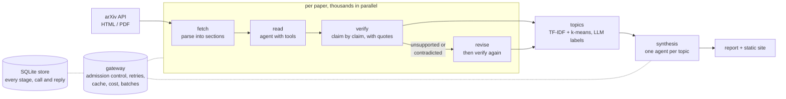

# Précis

[](https://github.com/MatiiiBL/precis/actions/workflows/ci.yml)


Précis reads thousands of research papers in parallel with LLM agents and
turns them into verified, structured summaries and a map of the field.

Each paper is read by an agent that moves through the paper's sections with
tools instead of receiving the whole text. A second agent checks every claim
in the summary against the paper and has to quote its evidence. Summaries
with unsupported or contradicted claims are rewritten and checked again.
The corpus is then clustered into topics, and Précis writes a report and a
searchable static website.

All model traffic goes through one gateway that handles rate limits,
retries, caching, cost accounting and the Message Batches API. A run of
several thousand papers can therefore be killed at any point and resumed
without paying twice for any request.



## Results so far

| What | Result |
|---|---|
| Papers downloaded | **2,918** arXiv cs.AR (computer architecture) papers from Jul 2025 to Oct 2026, at arXiv's polite pace of one request every 3 s |
| Papers parsed | **2,896 (99.2%)**: 91.5% from arXiv's HTML, 7.7% from the PDF; median 8,670 tokens, 29.3 M tokens in all ([details](docs/ingest.md#the-full-corpus)) |
| Whole pipeline on that corpus, offline | 2,889 papers read, verified and revised in 42 s (14,063 requests); topics in 5 s, report in 2 s, a 2,918-page site in 0.6 s |
| Throughput under API rate limits (simulated) | **166 papers/min**: 2,000 papers in 12 simulated minutes, using 97% of the input-token limit with **zero** 429s ([benchmark](docs/evaluation.md#offline-benchmarks)) |
| Crash recovery | Run killed with SIGKILL partway through, with 9% of requests failing on purpose: **500/500 papers finished, none lost, 0 requests paid twice** |
| Reading with tools vs. the whole text | The reader agent opens 53% of each paper. Its token use grows 0.45 tokens per token of paper vs 1.0 for full text, and it was the cheapest of the three strategies ([measurements](docs/agents.md#7-measurements-offline)) |
| Batch mode | Same work for 52% less ($7.70 vs $16.14 for 200 papers at Claude Opus 5.5 prices) |
| Code | 15k lines of Python and 8.5k lines of tests (486 tests); `mypy --strict`; CI on Python 3.12 and 3.13 |

The offline and simulated rows measure the system's machinery: scheduling,
admission control, retries, caching and resumption. Deterministic stand-ins
play the models. Measuring summary quality with a real model takes a run
against the API. The tools for it are built and tested: recall of the
paper's key points without its abstract, claim faithfulness, and a
comparison of the three reading strategies. Their results will go in
[docs/evaluation.md](docs/evaluation.md#real-model-results).

## Quick start

Requires [uv](https://docs.astral.sh/uv/). No API key is needed for offline
mode.

```sh
git clone https://github.com/MatiiiBL/precis && cd precis
uv sync

# Download and parse 30 recent computer-architecture papers (about 2 minutes).
uv run precis fetch arxiv --category cs.AR --since 2026-10-01 --limit 30

# Read, verify and revise them with deterministic offline stand-ins for the models.
uv run precis run --offline

# Topics, a written report, and a static site.
uv run precis topics --offline
uv run precis report --offline        # reports/report.md
uv run precis site                    # build/site/index.html

uv run precis status                  # stages, runs, tokens and cost
```

With an API key, drop `--offline`:

```sh
export ANTHROPIC_API_KEY=...
uv run precis run --max-cost 5        # stops admitting papers once $5 has been spent
uv run precis run --mode batch        # Message Batches API: half price, slower
uv run precis eval faithfulness       # verdict rates of the stored summaries
```

Interrupt any command with Ctrl-C and run it again to resume. A real run
redoes the work of an offline run on the same store: offline results are
kept apart and never served as model output.

## How it works

**Ingest** ([docs/ingest.md](docs/ingest.md)). The arXiv search API pages
through a category and date range. For each paper Précis downloads arXiv's
HTML rendering, which has real section structure, and falls back to the PDF.
Both are parsed into a `Document`: a tree of sections, figure and table
captions, and text with math kept as LaTeX. A quality gate rejects garbled text, such
as PDFs whose fonts decode to nonsense, before any model sees it. Raw files
are kept, so a parser change re-parses the corpus without downloading
anything: the whole corpus re-parses in 3.5 minutes.

**Agents** ([docs/agents.md](docs/agents.md)).
- **Reader.** It sees the paper's outline and uses `read_section`,
  `search_paper` (BM25 over the paper's passages) and `read_captions`. It
  finishes by calling `submit_summary` with a strict JSON schema: TL;DR,
  problem, approach, findings with their numbers, contributions,
  limitations, methods and datasets.
- **Validation.** A submission whose numbers do not appear in the paper is
  rejected, and the agent is told why.
- **Critic.** It returns a verdict for the TL;DR and for each finding:
  supported, partial, unsupported or contradicted. Each verdict carries a
  verbatim quote. Quotes are looked up in the paper, and a "supported"
  verdict whose quote is not there is downgraded.
- **Reviser.** It re-reads the sections behind the failed claims and
  rewrites them, and the new summary is verified again.
- **Untrusted text.** Paper text is fenced and treated as data, not
  instructions; there is a prompt-injection test fixture.
- **Other strategies.** Full text in one request, and map-reduce over
  chunks, exist for comparison.

**Gateway** ([docs/runtime.md](docs/runtime.md)). Every request goes
through one place:
- **Admission control.** An adaptive concurrency window works like TCP: it
  starts by doubling, backs off by halving on 429 or 529, then grows by one.
  Token buckets enforce requests, input tokens and output tokens per
  minute, at limits learned from the API's rate-limit headers.
- **Retries.** With jittered backoff, following `retry-after`.
- **Response cache.** Keyed by a hash of the request.
- **Cost accounting.** Cache writes and reads, the batch discount and the
  model a fallback was served by are all priced. The budget cap counts each
  request's reserved cost before it is sent, so 64 requests in flight
  cannot all slip under the cap at once.
- **Batch mode.** Requests go through the Message Batches API without the
  agents knowing. Open batches are stored, so a crashed run collects their
  results instead of buying them again.
- **Atomic writes.** A reply's call record and its cache entry are written
  in one SQLite transaction, which is what makes "never pay twice" hold
  under SIGKILL.

**Store and resumption.** One SQLite file in WAL mode holds the papers, the
documents, every stage's result, every model call and the response cache.
Each stage result is keyed by a hash of everything that determines it:
model, prompts, tool definitions, options and the stage's inputs. Re-running
skips what is done, and changing a prompt re-runs exactly the stages that
use it.

**Corpus** ([docs/evaluation.md](docs/evaluation.md)). Summaries are
clustered with TF-IDF, truncated SVD and k-means, with k chosen by
silhouette score, and an LLM names each topic. A synthesis agent writes one
section per topic, citing papers. Citations to papers outside the topic are
removed and counted. The site is static HTML with client-side search and
one page per paper, showing the summary, each claim's verdict and its
evidence.

## Design decisions

- **Navigate, don't stuff.** Sending the whole paper costs tokens in
  proportion to its length. A reader that chooses what to open costs a
  fixed overhead plus what it reads, and about half of that is prompt-cache
  reads at a twentieth of the input price on Claude Opus 5.5. On papers over
  12,000 tokens, the offline reader used a quarter fewer tokens than full
  text (median 12,470 vs 16,535).
- **Verify with quotes, and check the quotes.** Without evidence, a verdict
  is just another generation. Requiring a verbatim quote, and checking it
  against the paper, makes "supported" falsifiable and the false-quote rate
  measurable.
- **One gateway, and agents that don't know about rate limits.** Retries,
  backoff and batching live in one place that can be tested against a fake
  API with injected faults. The agents just call `create`.
- **Simulated time for benchmarks.** A virtual clock advances only when
  every task is waiting. A 2,000-paper run under realistic latency and rate
  limits then takes 30 s of wall time and gives the same result for the same
  seeds on any machine.
- **Spend is a resource like any other.** The budget is a cap on everything
  recorded in the store, so an interrupted run resumed with a higher cap
  still stops at the cap, not at the sum of both caps.

## Testing

`make check` runs ruff, `mypy --strict` and pytest. Tests never touch the
network or the API.
- `FakeAnthropic` implements the SDK surface the gateway uses: streaming,
  batches, server-side rate limits, faults and prompt-cache usage. It
  returns real SDK message objects.
- Deterministic offline stand-ins play every model role, so every CLI
  command is tested end to end.
- Property tests (Hypothesis) cover sectioning, passage search and the
  rate limiter.
- Durability tests cut a run off between writes that must stay together,
  and the faults benchmark kills a running pipeline with SIGKILL.
- `pytest -m network` runs an optional smoke test against arXiv.

## Repository layout

```
src/precis/
  sources/   arXiv search, polite HTTP, HTML/PDF download, the fetch runner
  text/      HTML and PDF parsing, sectioning, quality gate, BM25
  agents/    reader, critic, reviser, tool loop, prompts, strategies
  pipeline/  stage scheduler, config hashes, live progress
  llm/       gateway, admission control, batches, pricing, fake API, clocks
  corpus/    topics, synthesis, report, static site
  eval/      evaluations, judge, benchmarks, virtual clock
  store.py   SQLite store        models.py  every record that crosses a package
  cli/       the precis command  offline.py the offline client
docs/        design, one document per package
results/     benchmark tables (Markdown and JSON)
```

Start with [docs/design.md](docs/design.md), which defines the contracts
between packages. Each package has its own document with measurements:
[ingest](docs/ingest.md), [agents](docs/agents.md),
[runtime](docs/runtime.md) and
[corpus and evaluation](docs/evaluation.md).

## Limitations

- **No real-model results yet.** Quality numbers need a run against the
  API; the harness and its tests are in place.
- **Offline numbers measure machinery, not judgement.** How much a real
  model chooses to read, and how often it gets rejected or revised, will
  differ.
- **Some PDFs lose structure.** About 8% of papers have no usable HTML.
  Their PDFs, many made with Word, are parsed with a heuristic outline
  finder. Scanned or badly encoded PDFs fail the quality gate, by design.
- **Quote checks have gaps.** A quote is accepted if it appears anywhere in
  the paper, not necessarily in the cited section. The number check cannot
  see numbers written as words.
- **One machine.** It runs on one machine, one event loop and one SQLite
  file. That is plenty for tens of thousands of papers, since the bottleneck
  is the API's rate limit, but it is not a distributed system.

## License

MIT
