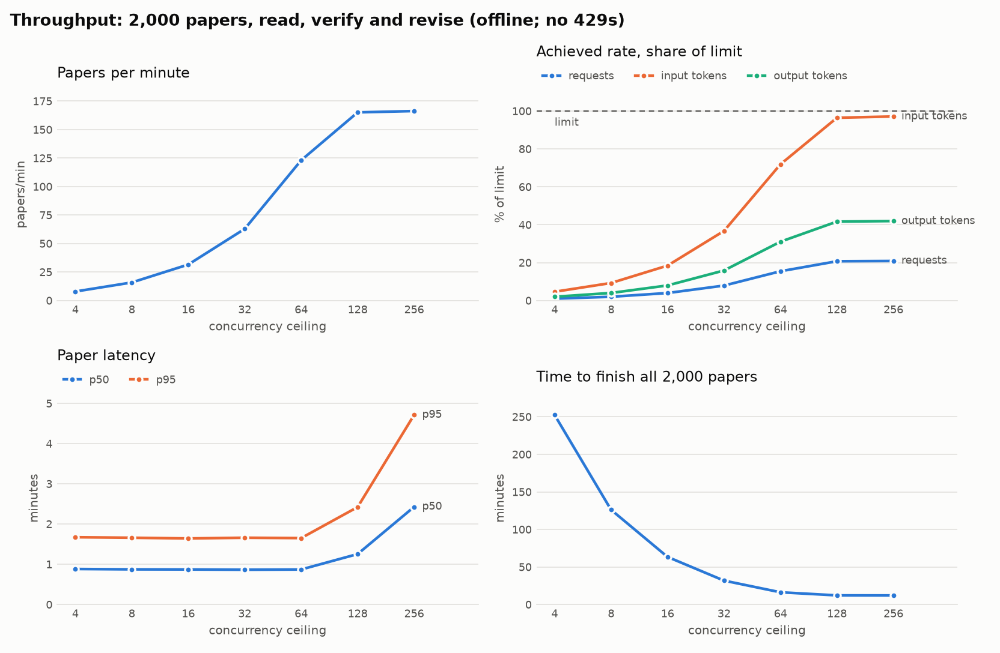

# Corpus outputs, evaluation and benchmarks

This document covers the packages that run after the per-paper pipeline
(`precis.corpus`, `precis.eval`): turning a few thousand verified summaries
into topics, a written report and a static site, and measuring how good the
summaries are and how fast the pipeline runs. Section 6 has the numbers.

| Command | What it does | Requests |
|---|---|---|
| `precis topics [--k N]` | cluster the summaries, name each topic | one per topic |
| `precis report [--out PATH]` | synthesize each topic, write the introduction, render Markdown | one per topic (more for large topics), plus one |
| `precis site [--out DIR]` | render the static site | none |
| `precis eval abstract [--n N]` | summaries written without the abstract vs the abstract | reader runs plus two judge requests per paper |
| `precis eval faithfulness` | verdict rates before and after revision, quote audit | none |
| `precis eval ablation [--n N]` | agentic vs fulltext vs mapreduce on the same papers | three reader runs, a critic run and judge requests per paper |
| `precis bench throughput [--papers N] [--concurrency C ...]` | the full pipeline offline over 2,000 papers, across concurrency ceilings | simulated |
| `precis bench faults [--papers N]` | injected API errors and a crash mid-run, then a resume | simulated |

All model requests go through `ModelGateway`. Every command that makes
requests accepts `--offline`, which answers with deterministic stand-ins
(`precis.corpus.offline` and `precis.eval.offline`, collected with the
agents' in `precis.offline`), so the whole path runs in CI without an API
key; the benchmarks are always offline.

## 1. Topics

**Text.** A paper is clustered on its summary's tldr, approach, methods and
keywords: what it does and with what. Findings are left out on purpose; they
are mostly numbers and benchmark names, which group papers by evaluation
setup rather than by subject.

**Vectors.** TF-IDF with sublinear term frequency over unigrams and bigrams,
then truncated SVD to 100 dimensions and L2 normalization (classic latent
semantic analysis). Two details matter more than the choice of algorithm:

- *Stop words.* Besides English stop words, about 150 words of research
  prose ("propose", "novel", "outperform", "significantly", "framework",
  "performance") are removed. In LLM-written summaries these are the most
  frequent content words, and left in they pull every cluster towards the
  same centre.
- *Phrases.* Bigrams are formed only inside a clause or list item, so the
  keyword list "cache replacement, prefetching" yields "cache replacement"
  but not "replacement prefetching". Without this rule, phrases that no
  paper uses, such as "replacement memory", made it into the topic
  keywords.
- *LaTeX.* Summaries copy math from papers. Commands and delimiters are
  dropped and their arguments kept, so `$\mathrm{PRAC}$` counts as "prac";
  before this, one topic was named "Mathrm Prac and Dram Timing".

Embeddings would be the other option. LSA was chosen because the summaries
are short, dense and written in one consistent style (which is where TF-IDF
works well), because it needs no second model, service or GPU, and because
it is fast and exactly reproducible: the same summaries and seed give the
same topics, which keeps the response cache valid for the naming requests.

**Clustering.** k-means on the unit vectors (that is, cosine k-means), with
`n_init=8`. k is the value in `corpus.k_min..k_max` (default 6..24) with the
highest cosine silhouette score, unless `--k` or `corpus.k` gives it. The
silhouette score rewards tight clusters, and on a small corpus the tightest
clusters are single papers: on 45 real papers it chose k = 21, with five
one-paper and eleven two-paper topics. The search is therefore capped at
about sqrt(n) topics and skips any k that leaves a topic smaller than
`corpus.min_topic_size` (3) papers. Topic ids are assigned by size, largest
first, and each topic's papers are ordered by cosine similarity to the
centroid, so "the most representative papers" is simply the head of the
list.

**Keywords.** Class-based TF-IDF: each cluster's texts are treated as one
document and a term scores `tf(term, cluster) * log(1 + A / f(term))`, where
`A` is the average number of words per cluster and `f` the term's corpus
frequency. Plain TF-IDF over papers would reward terms that are rare
everywhere; this rewards terms frequent in the cluster and rare elsewhere.
A bigram replaces the unigrams it contains ("cache replacement" instead of
"cache" and "replacement"), since unigrams almost always outscore the
phrases that contain them.

**Naming.** One structured-output request per cluster (role
`agents.synthesizer`), showing the cluster's keywords, its eight most
central papers (title, tldr, keywords) and the keywords of every other
cluster. The other clusters are there for contrast: without them, sibling
clusters in one field get near-identical names.

**Measured** (Apple M4 laptop, 2,500 synthetic summaries from 12
overlapping themes): the silhouette search over k = 6..24 takes 1.5 s and
picks k = 11 (silhouette 0.266, tied with 13); a fixed k takes 0.12 s;
keywords take 0.05 s. On a corpus with four planted, disjoint themes the
search recovers k = 4 with cluster purity 1.0 (`tests/corpus/test_topics.py`).

**Caveat.** The silhouette score measures separation, not usefulness, and
it is often flat: in the run above every k from 10 to 24 scored within
0.025 of the best. Treat the chosen k as a reasonable default and pass
`--k` when you know the granularity you want.

## 2. Synthesis and report

Each topic gets one request that writes a `TopicSynthesis`: a 3-5 paragraph
overview, trends, open problems and key papers, citing papers as
`[arXiv:<id>]`. The model sees compact summaries (tag, title, tldr and
findings; about 240 tokens for a summary with a 40-word tldr and four
findings), not full summaries: that is what a synthesis needs, and it lets
a topic of about 250 papers fit in one request.

**Fitting the context window.** `corpus.synthesis_input_tokens` (60,000 by
default) caps the paper text in one request, far below the model's 1M
context: long inputs cost more, take longer and get less even attention. A
larger topic is never truncated. Its papers are dealt round-robin, in
centrality order, into the fewest chunks that fit, so every chunk is a
cross-section of the topic rather than its most or least typical slice;
each chunk gets a partial synthesis, and the partials are merged, in groups
and recursively if they do not fit together. A 1,000-paper topic at the
default budget takes four partial requests and one merge. A single paper
larger than the budget is an error, not a cut.

**Citations.** After each request, every citation is checked against the
topic's papers. A citation of a paper outside the topic (a hallucinated id,
or a paper from a neighbouring topic) is removed, and the counts are stored
with the report and printed in its closing section. Grouped citations
(`[arXiv:a, arXiv:b]`) are split, since models produce them despite the
instruction. Key papers outside the topic are dropped; if none is left, the
three most central papers are used.

**Failures.** A topic whose synthesis fails (a refusal, a reply truncated
twice or invalid, retries exhausted) is left out of the report and named in
its closing section and in the command's output, instead of failing the
whole report. Running `precis report` again retries it; the topics that
succeeded come back from the response cache at no cost.

**Introduction.** A last request writes the title and introduction from the
corpus statistics and each topic's name, size, description and trends (with
citations stripped, since the introduction does not cite).

**Rendering.** `precis report` writes one Markdown file with a table of
contents whose links use GitHub's heading anchors, a numbered section per
topic with citations linked to arXiv, and a closing section with
faithfulness, citation and spend figures.

**Requests.** All corpus and judge requests are single-shot structured
outputs (`output_config.format`, adaptive thinking, the role's `effort`)
that share the agents' strict schemas (`agents.schema.strict_schema`) and
sending rules (`agents.messages.send`): a reply cut off at `max_tokens` is
discarded and the request sent once more with twice the limit, and a
refusal raises. They carry no `cache_control`: each has a unique body after
a short system prompt that is below the minimum cacheable prefix, so a
breakpoint would only add the cache-write premium. Prompts are deterministic (sorted inputs, no
timestamps), so re-running `precis topics` or `precis report` on unchanged
summaries is served entirely from the gateway's response cache
(`tests/corpus/test_cli.py` checks this).

## 3. Site

`precis site --out build/site` renders, with Jinja2:

- `index.html`: corpus facts, faithfulness before and after revision (a
  stacked bar per stage), the introduction, topic cards, and spend by stage;
- `topics/<id>.html`: the synthesis with linked citations, key papers, and
  every paper in centrality order;
- `papers/<id>.html`: the summary, with the critic's verdict as a badge on
  the tldr and on every finding and the quoted evidence under it, plus
  limitations, methods, datasets, keywords and arXiv links;
- `search.html`: client-side search over every paper's title, tldr,
  keywords, authors and topic.

There are no external scripts, fonts or stylesheets, and the site works
from a `file://` URL. That is why the search index is a JSON document
assigned to a global in `assets/search-index.js` rather than a `.json`
file: browsers refuse `fetch` on `file://` pages. Only the search page
loads it; every other page has a plain form that opens the search page, and
no JavaScript at all. Model-written Markdown is rendered with raw HTML
disabled, so a stray `<script>` in a synthesis shows up as text. Colors
follow `prefers-color-scheme`, and the layout collapses to one column on
phones.

**Measured** with 2,500 papers: 2,504 pages and 10.3 MB written in 0.53 s;
a paper page is about 3.5 KB; the search index is 765 KB (about 300 bytes
per paper), and a two-word query scans all 2,500 entries in 0.7 ms in
Orca's built-in browser (Chromium), so search runs on every keystroke
without an inverted index.

## 4. Evaluation methodology

### 4.1 Summaries without the abstract (`precis eval abstract`)

The reader normally sees the abstract. For this evaluation it does not
(`include_abstract = false`), and the authors' abstract becomes an
independent reference: a summary written from the body alone should
recover what the authors say their paper is about. `--n` papers (default
`eval.n = 50`) are sampled with a fixed seed from the papers that have full
text and an abstract.

- **ROUGE-1/2/L F1** (`rouge-score`, Porter stemming) between the abstract
  and the summary's tldr, problem, approach and findings. ROUGE counts
  shared words, so it is low for any abstractive summary and rewards
  copying; it is reported next to a *mismatched* baseline, each summary
  scored against another paper's abstract from the same corpus, which shows
  how much overlap the field's shared vocabulary produces on its own. Only
  the gap between the two columns says something about the summary.
- **Key-point recall.** A judge request (role `agents.judge`) extracts 3-6
  key points from the abstract: the problem, the approach and each main
  result, keeping the abstract's numbers. A second request shows the judge
  the key points and the summary, *not* the abstract, and asks which points
  the summary conveys. Recall is the share covered. The extraction depends
  only on the abstract, so it is made once per paper and served from the
  cache for every summary compared with it. A malformed judgment (a point
  left out or numbered twice) counts as not covered, so it can only lower
  recall.

Means come with 95% percentile-bootstrap intervals (2,000 resamples). With
50 papers the interval on recall is about +-5 points, which is the
resolution at which two configurations can be told apart.

**Caveats.**

- *The abstract is not ground truth.* Abstracts oversell, omit limitations
  and sometimes state results the body qualifies. A summary that is more
  careful than the abstract loses recall for it.
- *Judge bias.* LLM judges are lenient towards paraphrase and can be swayed
  by fluent, longer text. The judge sees one summary at a time with a
  binary question per key point, which limits but does not remove this.
- *Same-family judge.* By default the reader, the critic and the judge are
  all `claude-opus-5-5`. A model judging its own family's writing tends to
  rate it favourably (self-preference), so absolute recall is likely
  optimistic; comparisons between configurations judged by the same judge
  are more trustworthy than the absolute number. Setting
  `[agents.judge] model` to another model is the cheap check.

### 4.2 Faithfulness (`precis eval faithfulness`)

Computed from stored results, with no requests:

- **Verdict rates per claim** (supported, partial, unsupported,
  contradicted), where a claim is the tldr or one finding, for all first
  drafts, all final summaries, and the revised papers alone before and
  after revision.
- **Quote audit.** Every check must quote the paper verbatim. Each quote is
  looked up with the critic's own matcher (`PaperView.contains_quote`:
  case, Unicode forms, typographic quotes and dashes and whitespace folded,
  `...` treated as a gap, section titles not counted as text), so the audit
  disagrees with the critic only where the critic's downgrade did not
  apply. A quote that is not found means the critic paraphrased or invented
  its evidence; the audit reports how often, and how many of those checks
  still said "supported" (the critic downgrades them to "partial", so a
  non-zero count means records written before that check existed).
- **Examples**: failed claims from revised papers with the critic's note and
  the rewritten claim.

**Caveats.** The verdicts are a model's judgments, not ground truth; the
critic is the same model family as the reader. The revised-only
before/after comparison has a selection effect: those claims were chosen
because they failed, and the same critic re-checks text written in
response to its own notes, so the "after" rate is an upper bound on how
much revision helps. A random sample of verdicts checked by hand is the
honest calibration.

### 4.3 Strategy ablation (`precis eval ablation --n N`)

The three summarization strategies run on the same `N` papers, all without
the abstract: `agentic` (the reader navigates sections with tools),
`fulltext` (one request with the whole body) and `mapreduce` (notes per
chunk, then a combining request). Each summary is then scored with the same
critic and judge. Reported per strategy: requests, uncached input, cache
write, cache read and output tokens, and cost per paper (summarizing only);
p50 and p95 latency per paper; key-point recall and ROUGE-L; supported
claims. Strategies run one after another, so each has the gateway to itself
and its latencies are not inflated by another's traffic.

Tokens and cost come from the call records, not from token sums: pricing
depends on each request's prompt size, and a request served from the
response cache is counted with the usage and cost of the response it
replays, so a re-run reports the same cost. Latency is wall time per paper
on the gateway's clock and is reported only for papers whose requests were
all sent; a re-run, or the agentic strategy right after `eval abstract`
(which summarizes the same sample the same way), shows "n/a". Offline, both
evaluations run on virtual time against the benchmark's latency model, so
their latencies are simulated rather than zero.

## 5. Benchmarks

The benchmarks run the real per-paper pipeline (scheduler, agents, gateway,
store) against `FakeAnthropic`, which serves deterministic offline
responses with a latency model and enforces server-side rate limits with
`429` and `retry-after`, like the API.

**Virtual time.** The scaled clock from `precis.llm` runs simulated time a
fixed factor faster than wall time. That breaks down at this scale: a
simulated run of 10,000 requests at hundreds of requests per minute only
finishes in seconds with a speed-up in the thousands, at which the event
loop must handle thousands of requests per wall second; it falls behind, and
its own CPU time turns into simulated latency. `precis.eval.simclock.VirtualClock` instead advances time only
when every task is waiting on the clock, jumping straight to the next
wake-up. A simulated hour then costs only the CPU time of processing its
requests, the result does not depend on the machine, and the same seeds
give exactly the same run.

A wait shorter than the float spacing of the current time would leave a
virtual clock where it was, and a token bucket a rounding error short of
capacity then waits forever; the first 2,000-paper run spent minutes of CPU
in that loop. Sleeps are rounded up to 1 ms, the granularity of a real event
loop's timers.

**Throughput setup.** 2,000 papers from `precis.eval.synthetic` (median body
8,500 tokens), all three stages with the default agentic reader, the offline
responders for every role, and `FakeAnthropic`'s usage and prompt-cache
model at `claude-opus-5-5` prices.

- *Server:* 4,000 requests, 2,000,000 input tokens and 400,000 output tokens
  per minute, continuously refilled buckets that answer `429` with
  `retry-after`. Input counts uncached input and cache writes; cache reads do
  not count, as on the API.
- *Latency:* 2 s to the first token plus 20 ms per output token (about 50
  tokens/s, thinking included), with log-normal jitter (sigma 0.35).
- *Client:* the gateway's defaults (adaptive concurrency from 8, doubling
  per window of successes until the first 429/529, then growing by one per
  window and halving on 429/529; token buckets learned from the
  `anthropic-ratelimit-*` headers), with the concurrency ceiling set
  to the swept value and `2 x ceiling` papers in flight so the scheduler
  never starves the gateway. Each ceiling runs on a fresh store.

Reported: papers per simulated minute; achieved request, input and output
token rates against the limits; the share of responses that were 429s; the
adaptive window at the end; and p50/p95 paper latency, from a paper's first
request to its last response, admission waits and retries included.

**Fault setup.** 500 papers at a ceiling of 32, with per-request faults far
above a normal day: 4% `429` (retry-after 5 s), 2% `529`, 2% `500` and 1%
timeouts (30 s). The first run is a child process on a store file; once 40%
of the papers are finished the parent kills it with SIGKILL, so no handler
runs and SQLite recovers its write-ahead log on the next open. The parent
then runs the pipeline again over the same store, which resets the stages
left `running` and skips the finished ones. A responder in the child logs
the hash of every request that reached the model, so the requests that were
sent but never answered can be counted. The run passes if every paper ends
with all stages in a terminal state and no request hash has more than one
paid response.

## 6. Results

### Offline benchmarks

These measure the machinery (scheduling, admission control, retries,
resumption) under realistic sizes, limits and latencies, not a model's
judgement: the offline responders read about half of each paper in two turns
and make about five requests per paper over the three stages. Measured on an
Apple M4 laptop; the simulated numbers are exactly reproducible.

**Throughput** (`uv run precis bench throughput`, `results/bench-throughput.md`):

| Ceiling | Papers/min | Requests/min | RPM used | ITPM used | OTPM used | 429s | Final window | p50 paper (min) | p95 paper (min) |
| ---: | ---: | ---: | ---: | ---: | ---: | ---: | ---: | ---: | ---: |
| 4 | 7.9 | 40 | 1% | 5% | 2% | 0 | 4 | 0.9 | 1.7 |
| 8 | 15.9 | 80 | 2% | 9% | 4% | 0 | 8 | 0.9 | 1.7 |
| 16 | 31.6 | 159 | 4% | 18% | 8% | 0 | 16 | 0.9 | 1.6 |
| 32 | 62.9 | 316 | 8% | 37% | 16% | 0 | 32 | 0.9 | 1.7 |
| 64 | 123.1 | 618 | 15% | 72% | 31% | 0 | 64 | 0.9 | 1.7 |
| 128 | 165.1 | 829 | 21% | 96% | 42% | 0 | 128 | 1.3 | 2.4 |
| 256 | 166.3 | 835 | 21% | 97% | 42% | 0 | 256 | 2.4 | 4.7 |

- **Up to a ceiling of 64, throughput is proportional to concurrency:**
  about 1.9 papers per minute per slot, as Little's law predicts for about
  five requests per paper and a mean response time of about 6 s. Paper
  latency stays flat (p50 0.9 min, p95 1.7 min) because nothing queues.
- **From 128 the input-token limit binds: 165-166 papers/min at 96-97% of
  the input tokens per minute, with no 429s.** The client's input-token
  bucket holds the rate just under the server's, which is what admission
  control is for; requests and output tokens have room to spare because
  cache reads do not count toward the input limit and the offline replies
  are short.
- **The adaptive window's start used to be the bottleneck.** In the first
  version of these runs the window grew by one slot per window of
  successes from 8, so reaching 128 took about 8,000 of the run's 10,000
  requests: throughput flattened at about 131 papers/min with 23% of the
  input-token limit unused (and only 108 at a ceiling of 64), and at 256
  the window ended the run at 142. The gateway now starts in slow start, as
  TCP does, doubling the window per round trip until the first 429 or 529,
  and only then grows it by one per window. Before and after, from the same
  seeds:

  | Ceiling | Papers/min, additive start | Papers/min, slow start | ITPM used | p95 paper (min) | Final window |
  | ---: | ---: | ---: | ---: | ---: | ---: |
  | 32 | 61.1 | 62.9 | 36% → 37% | 1.7 → 1.7 | 32 → 32 |
  | 64 | 108.1 | 123.1 (+14%) | 63% → 72% | 2.2 → 1.7 | 64 → 64 |
  | 128 | 130.6 | 165.1 (+26%) | 76% → 96% | 3.7 → 2.4 | 128 → 128 |
  | 256 | 132.0 | 166.3 (+26%) | 77% → 97% | 6.1 → 4.7 | 142 → 256 |

  That is within 0.4% (at 128) and 2.3% (at 256) of starting each run at its ceiling
  (`[limits] initial_concurrency = 256`, measured before the change: 165.8
  papers/min at 128 and 170.3 at 256), without having to know the right
  ceiling in advance, and with no 429 at any ceiling.
- **Latency grows once papers queue for admission:** with `2 x ceiling`
  papers in flight, p95 paper latency rises from 1.7 minutes at 64 to 4.7
  at 256, where the extra slots buy less than 1% more throughput than at
  128: once a token limit binds, more concurrency only lengthens the queue.
- **Admission control holds the limits exactly.** No ceiling produced a
  429. With the request limit lowered to 60 per minute and 64 slots, the
  gateway learns the limit from the response headers and stays under it
  (`tests/eval/test_bench.py`).
- **Cost of the benchmark itself:** 28-32 s of wall time per ceiling for
  2,000 papers (about 10,000 requests), about 3 ms of CPU per request, and
  300 MB of memory however many papers, since each run's store is a file and
  the fake's request log is off.

**Faults and crash recovery** (`uv run precis bench faults`, `results/bench-faults.md`):

|  | Value |
| --- | --- |
| Papers | 500 |
| Papers finished when the first run was killed | 201 |
| Stages running at the kill | 64 |
| Requests in flight at the kill | 1 |
| Requests answered in the killed run | 1,091 |
| Requests in the resumed run | 1,426 |
| of which served from the cache | 46 |
| of which in flight at the kill, sent again | 1 |
| Work kept: stages finished before the kill | $16.92 |
| Work kept: replayed from the cache on resume | $0.26 |
| Total cost of both runs | $40.03 |
| Retries in both runs | 256 |
| Faults injected in the resumed run | 66 x 429, 27 x 529, 38 x 500, 17 x timeout |
| Papers done / failed / lost | 500 / 0 / 0 |
| Requests paid for twice | 0 |

Every paper finished and no request was paid for twice. Of the 64 stages
running at the kill only one had a request in flight: with 9% of requests
failing, the adaptive window keeps halving, so most open stages were waiting
for a slot or a backoff. The resume skipped the 201 finished papers ($16.92
of work), replayed 46 completed turns of interrupted stages from the cache
($0.26), and re-sent the one request whose response the crash lost. Both
runs together cost $0.080 per paper, in line with the $0.081 per paper of the
uninterrupted throughput runs (on a different subset of the synthetic
papers): the crash cost one re-sent request, and the failed attempts cost
nothing, since only answered requests are billed.

### Measuring a real model

Every number in this repository comes from offline runs, which need no API
key and spend nothing. The evaluations above are built and tested offline
but have not been run against the API: their results depend on the model,
and a run costs money. To measure a model, fetch papers as in the README,
then:

| Measure | Command | Method |
|---|---|---|
| Key-point recall and ROUGE-L of summaries written without the abstract | `precis eval abstract --n N` | 4.1 |
| Verdict rates before and after revision, and the quote audit | `precis run`, then `precis eval faithfulness` | 4.2 |
| Quality, cost and latency of each reading strategy | `precis eval ablation --n N` | 4.3 |
| Topics chosen and citations removed from the syntheses | `precis topics`, `precis report` | 1, 2 |

The commands write their tables to `results/*.md`. `precis run --max-cost
USD` caps the store's total spend, and `--mode batch` halves the price at
the cost of latency; running 20 papers in each mode first shows what a
paper costs with the chosen model before committing to a corpus.
