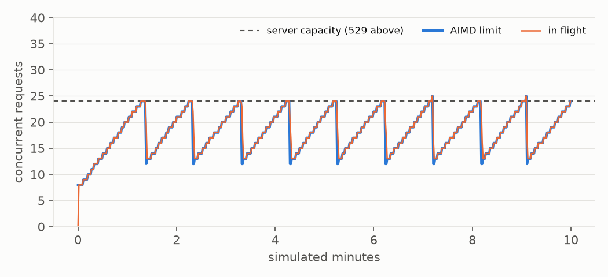

# Runtime: the store, the model gateway and the fake API

The runtime package is what every other package stands on. `precis.store`
keeps everything a run produces in one SQLite file. `precis.llm.Gateway` is
the only way any code talks to a model: it adds caching, a budget,
client-side rate limiting, retries, refusal fallbacks, cost accounting and
batching to every request. `precis.llm.fake.FakeAnthropic` stands in for the
Anthropic SDK client, so the whole pipeline (and this package's own
benchmarks) run without an API key, deterministically, in simulated time.

| Module | Responsibility |
|---|---|
| `store.py` | SQLite schema, migrations, typed reads and writes |
| `llm/gateway.py` | `Gateway`, `GatewayStats`: the request path below |
| `llm/limiter.py` | token buckets, the AIMD concurrency window, `Admission` |
| `llm/batch.py` | batch mode: queue, flush, poll, file every result, collect open batches |
| `llm/pricing.py` | prices per model, `cost(usage, model, batch)`, `reply_cost(reply)` |
| `llm/models.py` | which models support server-side fallbacks, and to what |
| `llm/clock.py` | `Clock` protocol: real, scaled and manual time |
| `llm/client.py` | the SDK surface the gateway uses (a `Protocol`), `make_client` |
| `llm/errors.py` | `GatewayError`, `RefusalError`, `BudgetExceeded` |
| `llm/fake.py` | `FakeAnthropic`, `FakeReply`, latency, faults, server limits |

## The request path

```
create(params, stage, paper_id)
  │
  ├─ cache hit (readable)? ──────────────────► LLMCall(status="cached", $0) ──► reply
  ├─ budget: total spent + reserved + this reservation > max? ──► BudgetExceeded
  │
  ├─ online ─┬─ wait for a concurrency slot (AIMD window)
  │          ├─ wait for request / input / output token buckets
  │          ├─ stream it (beta endpoint + fallbacks if supported)
  │          ├─ 429 / 529 / 5xx ─► back off, release, try again (≤ max_attempts; timeouts once)
  │          └─ correct the reservation from usage, learn limits from headers
  │
  ├─ batch ──── queue ─► Message Batches API ─► poll ─► file every result ─► route by custom_id
  │
  └─ LLMCall(each attempt at its model) ─► refusal? RefusalError : cache (unless truncated)
```

`params` are exactly the keyword arguments of `client.messages.create`, so
agent code builds requests the way the SDK documents them and the gateway
never has to understand a prompt. The request hash is
`sha256(canonical_json(params))`; a stored response for the same hash is
returned without a request and recorded as a `cached` call that costs
nothing and counts no tokens (no tokens were processed).

What goes into the cache matters as much as what comes out, because a bad
entry replays forever:

- Replies are stored with the API's field names (`to_dict`), the form
  `model_validate` reads back. The first version stored SDK field names, and
  a fallback's `fallback` block (field `from`, attribute `from_`) could then
  never be read: every resume of that paper failed. A row that no longer
  validates is now deleted, logged and treated as a miss.
- Refusals, errors and replies cut off at `max_tokens` are never cached:
  the caller retries those with different settings or gives up, and a
  replay would only repeat the failure.
- Requests are deterministic by design, so retrying a stage that failed on
  model behaviour would replay the same replies. `Gateway.cache_scope(salt)`
  mixes a salt into the hash of every request made inside the block (a
  `ContextVar`, so tasks started inside inherit it): the scheduler wraps the
  re-execution of a failed stage in `cache_scope(f"attempt-{n}")`, which gets
  fresh replies, while a crash during that attempt still resumes from its
  own entries. The empty salt is the plain hash, so existing rows stay valid.

## Store

One SQLite file in WAL mode, opened in autocommit mode: every write is its
own short transaction, so a crash loses at most the requests that were in
flight, and readers (a `precis status` in another terminal) never block the
writer. Writes run inline on the event loop: recording an LLM call takes
about 45 µs on a laptop SSD (2,000 writes to a WAL file), less than the
overhead of handing it to a thread, and `usage()` over those 2,000 calls
takes under a millisecond.

Each record is stored as the JSON of its pydantic model and validated back
into that model on read, so a schema drift fails loudly at the boundary
instead of leaking half-parsed data into the pipeline. Next to the JSON sit
only the columns that queries filter, sort or aggregate on, each with an
index for the query that uses it: papers by `(published DESC, id)`, a
`paper_categories` table so `list_papers(category=...)` matches any listed
category through an index, stages by `(stage, status, paper_id)` for the
scheduler's "what is pending" query, and LLM calls by `(run_id, stage,
model)` so `usage()` is a `GROUP BY` in SQLite rather than a loop in Python.

The schema carries a version number. `MIGRATIONS[i]` upgrades version `i` to
`i + 1` inside one transaction; opening an older store runs the missing
migrations, and opening a store written by a newer version raises
`SchemaError` instead of guessing. The test suite exercises the path by
appending a migration and reopening an existing file.

## Admission control

The Messages API limits each model by requests, input tokens and output
tokens per minute, enforced with token buckets that refill continuously.
Rather than discover those limits through 429s, the gateway mirrors them.

**Token buckets.** `Admission` keeps one bucket per limit. A bucket holds
`burst_s` seconds of its rate (10 s by default, so a 600 RPM bucket holds
100 requests): the API documents that it may enforce a per-minute limit
over shorter intervals, and a full minute of burst would invite exactly the
429 the bucket exists to prevent. A request reserves its *estimated* input
and output tokens; when the response arrives the reservation is corrected to
what the API counted (uncached input plus cache writes; cache reads do not
count toward input-token limits). An underestimate puts the bucket in debt,
which the next requests wait off, so the long-run rate stays honest even
when single estimates are wrong. A request larger than the whole bucket is
let through when the bucket is full, rather than never.

Estimates come from `util.estimate_tokens` over the prompt, scaled by a
per-stage moving average of counted/estimated input (which falls well below
1 for stages that read most of their prompt from the cache), and from a
per-stage moving average of output tokens. One bug worth recording: the
first version measured that ratio against reservations that already
included the previous ratio, so with many requests in flight it compounded
until a reservation exceeded every bucket and admission stalled. The
closed-loop simulation below found it within two simulated minutes; the
ratio is now always taken against the raw prompt estimate, and the
convergence tests guard it.

**Learning the limits.** Each limit in `[limits]` (`rpm`, `itpm`, `otpm`)
can be set, or left `None` to be learned. Every response carries the
`anthropic-ratelimit-{requests,input-tokens,output-tokens}-{limit,remaining,reset}`
headers (names checked against the live rate-limits page on 2026-11-11);
the gateway reads them through `with_raw_response`, adopts the server's
limit (or keeps a configured one if it is lower), and lowers a bucket to the
server's `remaining` when the server knows of usage the client does not,
such as another process sharing the key. Until the first response a bucket
is open. A 429's `retry-after` pauses all admissions for that long, not just
the request that received it: the server's bucket is empty for everyone.

**AIMD concurrency.** The buckets bound the rate; a separate window bounds
how many requests are in flight. It starts at `initial_concurrency` (8),
grows by one after each window of `floor(limit)` successful responses, and
halves on a 429 or 529, at most once per congestion event (all requests that
were in flight when the first overload arrived belong to the same event, as
in TCP). Other failures (5xx, timeouts) say nothing about capacity and leave
the window alone. Why not a fixed concurrency? The right number depends on
latency, model and account, and changes during a run; a fixed setting is
either too low (idle capacity) or too high (a 529 storm). The trade-off is
throughput: halving means the window spends its time between half and all of
the capacity.



Measured over ten simulated minutes against a fake that answers 529 to any
request arriving while more than 24 are in flight (64 closed-loop clients,
~4.5 s latency):

| Concurrency control | Successful requests/min | Responses that were 529 | Mean in flight |
|---|---|---|---|
| AIMD (8 → 64 ceiling) | 244 | 0.5 % | 18.2 |
| Fixed at 64 | 309 | 52.2 % | 24.1 |

A fixed window gets 27 % more through because the fake's overload answer is
nearly free (0.1 s) and retries land in the gaps; it does so by sending about
one failed request per successful one. Against the real API, where an
overloaded service is slow and every client's retries add to the load, the
AIMD sawtooth (one short 529 burst about once a minute here) is the
behaviour to want. The
halving factor is the knob if more throughput is wanted.

## Retries

The SDK client is built with `max_retries=0` (`make_client`) and the gateway
retries itself, because SDK retries happen behind the gateway's back: an
SDK-level retry of a 429 would not shrink the concurrency window, would not
pause other requests for `retry-after`, would not appear in `GatewayStats`
or in `LLMCall.attempts`, and its wait would not run on the injectable clock
the simulations depend on.

Every request is streamed (`messages.stream`, then `get_final_message()`;
the rate-limit headers come from the stream's response). A reply of 32,000
output tokens with thinking can take many minutes, and a non-streaming
request would sit on one HTTP read until `request_timeout_s` (600 s) cut it
off, after the server had generated, and possibly billed, the tokens. With
streaming the timeout bounds the wait for each chunk instead. The final
message is rebuilt as a plain `Message` or `BetaMessage`, so a live reply
and a cached one are the same type.

| Outcome | Retried | Window | Wait |
|---|---|---|---|
| 429 | yes | halve | `retry-after` (+ up to 1 s jitter), all admissions paused |
| 429 spend cap (`EnforcedSpendLimitReachedError`) | no | - | retrying cannot succeed until the cap resets |
| 529, or an `overloaded_error` event inside a started stream | yes | halve | full-jitter exponential backoff |
| other 5xx, `api_error` events, connection errors | yes | unchanged | full-jitter exponential backoff |
| timeout | once | unchanged | full-jitter exponential backoff; the request id is logged |
| other 4xx | no | unchanged | - |

An error inside a stream that has already started arrives from the SDK as
the base `APIStatusError` with status 200, so it is classified by its
`type`. A timeout is retried only once: each timed-out attempt may have been
generated and billed in full, and none of it would be recorded.

Full jitter waits a uniformly random time in `[0, min(60 s, 1 s · 2^(n-1))]`
before attempt `n + 1`, which spreads a burst of simultaneous failures
instead of retrying it in lockstep. The jitter comes from a `Random` seeded
by the run id, so a simulated run is reproducible. After `max_attempts` (8)
the request fails with `GatewayError` and is recorded as an `error` call.

## Refusals, fallbacks and the budget

With `pipeline.fallbacks` on, requests to models that support server-side
fallbacks (Claude Fable 5.2 and 5.1, Claude Opus 5.5 and 5, Claude Sonnet 5.5)
go through `client.beta.messages` with the `server-side-fallback-2026-07-01`
beta and `fallbacks="default"`, which lets the API pick the fallback model
by refusal category. Claude Haiku 5.5 has no server-side fallback, and the
Batches API rejects the parameter, so batch requests never carry it. A reply
whose final `stop_reason` is `refusal` raises `RefusalError` with
`stop_details.category`; it is recorded (refusals can be billed) but not
cached. Every model a fallback may route to is checked for a price when the
gateway starts.

`budget.max_cost_usd` is a cap on the total spend recorded in the store,
earlier runs included: the gateway starts from the sum of `usage()`
(`total_spent_usd`; `spent_usd` is this run's share). So `--max-cost 150`,
interrupted and resumed with `--max-cost 200`, spends at most $200, not
$350. Before each request the gateway reserves what it may cost and refuses
with `BudgetExceeded` when the total spent, plus the reservations of
requests in flight, plus this one would cross the cap. Counting in-flight
reservations keeps 64 concurrent requests from all passing the check at
once.

The reservation is deliberately not an average. Its uncached input is
priced at the cache-write rate of the request's `cache_control` TTL (1.25x
or 2x the input price), since that is what a cached prompt pays for its new
part, and its output at the largest reply the stage has produced so far, or
its whole `max_tokens` before the stage has produced one: the first reader
turn on Claude Opus 5.5 at 16,000 tokens reserves $0.32. A cap that cannot
fit even one such request says so in the error instead of quietly admitting
nothing. The cap can still be overshot by replies longer than their
reservation; the worst case is every request in flight writing its whole
`max_tokens`, about `max_concurrency x max_tokens x output price` (64 x
16,000 x $20/M ≈ $20 on Claude Opus 5.5, twice that for a turn retried at
32,000 tokens).

## Pricing and accounting

`llm/pricing.py` holds per-million-token prices for input, output, 5-minute
and 1-hour cache writes and cache reads for every current model, from the
Anthropic pricing page (retrieved 2026-11-11), including two details that
are easy to get wrong: cache reads are 0.05x the input price on Claude
Opus 5.5 and Sonnet 5.5 (not the usual 0.1x), and Claude Haiku 5.5 prices a
whole request at a higher tier once its prompt (uncached, written and read
tokens together) exceeds 100,000 tokens. The Batch API halves every price.
A reply is priced at the model that served it (`reply.model`), which after
a fallback is not the model requested; when its `usage.iterations` lists
several attempts (an attempt declined before a fallback, say), each is
priced at its own model and the costs are summed, since top-level `usage`
covers only the attempt that produced the reply. A model with no price is a
configuration error when the gateway starts, never a free call.

Each request becomes one `LLMCall` row: the reply that came back (status
`ok` or `refusal`), a `cached` hit, or an `error` row when it failed for
good. A row holds tokens by kind (top-level `usage`), the cost, the latency
of the last attempt (or, in batch mode, from queueing to result), the
number of attempts, the API request id, and whether it was a batch request.
Failed attempts before a success are counted in `attempts`, not recorded as
rows of their own.

## Batch mode

`Gateway(mode="batch")` serves the same `create` calls through the Message
Batches API at half price. Requests queue until `batch_max_requests` (500)
are waiting, their serialized size reaches `batch_max_bytes` (200 MB, under
the API's 256 MB), or `batch_max_wait_s` (30 s) after the first one; the
batch is then polled with doubling intervals from 10 s up to 120 s, its
results are streamed, and each result resolves the caller waiting on its
`custom_id`.
An agent awaiting `create` cannot tell the difference, so the multi-turn
agents run unchanged: each turn is one request in some batch. The cost is
latency, minutes per turn instead of seconds, which is acceptable for an
overnight corpus run and not for an interactive one.

Failed items are retried **in a later batch**, not online: the caller has
already accepted batch latency, and an online retry would forfeit the
discount. `errored` items with a server-side error, `expired` and `canceled`
items, and items missing from the results are requeued together once a
batch's results have been read (so they share one batch instead of
trickling into several); `errored` items with `invalid_request_error` would
fail again and fail the caller at once. If the API rejects a whole batch
with a 4xx (too large, or one malformed request), the batch is split in half
and each half sent on its own, down to the single request at fault, instead
of resending the same set until every caller fails.

**Results are paid for once a batch exists, so they are never thrown away.**
The first version lost them three ways: a polling outage longer than about
three minutes made it give up on a batch that was still running and send
its requests again (paying twice); Ctrl-C cancelled the callers, and
results that then arrived were dropped because only a waiting caller wrote
the cache; and a connection reset while streaming results failed every
caller. Now:

- every batch is recorded in the store (`record_batch`: custom id, request
  hash, stage and paper of each item) as soon as it is created, and closed
  only when its results have been read;
- every succeeded result is filed (an `LLMCall` row and a cache entry)
  whether or not its caller is still waiting;
- polling and result-stream errors retry the same batch with backoff up to
  `batch_poll_max_s`, indefinitely; the stream is reopened and entries
  already filed are skipped; items are requeued only once the batch has
  ended without them, or the API says it no longer exists;
- a gateway that starts on a store with open batches collects their results
  in the background (in either mode), and a batch-mode request whose result
  is in one of them waits for it instead of being sent again;
- `aclose()` does not wait: unsent requests are dropped, running batches stay
  recorded, and their ids are logged with a note that the next run collects
  them. Before, it waited, silently and up to 24 hours, for every batch to
  end after the progress view had closed.

Measured with 200 concurrent callers, `batch_max_requests=100`, and a fake
that errors 8 % and expires 4 % of batch items: the callers were served by
four batches of 100, 100, 21 and 2 requests; 21 requests needed a second
attempt and 2 a third; none failed; the cost was exactly half the cost of
the same 200 requests online.

## The fake API

`FakeAnthropic` implements `messages.stream`, `messages.create`,
`messages.with_raw_response.create`, the same under `beta.messages`, and
`messages.batches.{create,retrieve,results}`,
and type-checks as the same `AsyncAnthropicLike` protocol as the real client.
It returns the SDK's own `Message`, `BetaMessage` and `MessageBatch` objects
and raises the SDK's own exception classes (`RateLimitError`,
`OverloadedError`, `APITimeoutError`, ...) around real `httpx2` responses
with real headers, so code under test takes the paths it takes in
production.

Replies come from *responders*, functions from request params to a
`FakeReply` (or `None` to pass); the first reply wins. A `FakeReply` is
either a complete SDK `Message` or content blocks plus a stop reason, with
helpers for text, tool use and refusals. Around the responders the fake
models what the runtime reacts to:

- **Usage.** Input from `estimate_tokens`; prompt caching as a prefix match
  over tools, system and message blocks, with explicit and automatic
  breakpoints, 5-minute and 1-hour TTLs, read refresh and the 512-token
  minimum; output from the reply's content, capped by `max_tokens`.
- **Server limits.** `ServerLimits(rpm, itpm, otpm)` buckets that refill
  continuously, answer 429 with `retry-after`, and send the rate-limit
  headers on every response; `set_limits` changes them mid-run.
- **Faults.** Random or scripted (`fail_next`) 429, 529, 500, timeouts and
  400s; an error event or a timeout after a stream has started; 529 above a
  concurrency threshold; errored and expired batch items; Batches API
  outages on create, retrieve or mid-way through a results stream
  (`fail_batch_api`); a 413 for batches over `max_batch_bytes`.
- **Validation.** The documented 400s for request shapes current models
  reject (`temperature`/`top_p`/`top_k`, thinking budgets, forced
  `tool_choice` on Claude Opus 5.5), 404 for unknown models, and a
  `LookupError` when no responder matches, so a test fails loudly.
- **Fallbacks.** On the beta path with `fallbacks`, a refusal is replayed on
  the fallback model and reported the way the API does (a `fallback` block,
  `fallback_message` in `usage.iterations`, the served model in `model`).

All randomness comes from one `Random(seed)`. Time comes from a `Clock`:
`ScaledClock(100)` runs fifteen simulated minutes in about nine seconds of
wall time with every component keeping its real-world parameters, and
`ManualClock` lets a unit test assert that a retry waited exactly
`retry-after`.

## Measurements

Closed-loop simulation (`uv run python -m tests.runtime.simulate`): 64
clients send `claude-opus-5-5` requests back to back (~1,000 input and 300
output tokens each, ~4.5 s latency with 30 % log-normal jitter) against a
fake with 600 RPM, 1.2M ITPM and 240K OTPM. Nothing is configured; every
limit is learned from headers. At 450 s the fake halves its request limit.

| Measure | Result |
|---|---|
| 429 responses | 0 of 6,141 |
| Requests/min, 240-450 s (window settled) | 604 of 600 |
| Requests/min, 60-450 s (includes the ramp) | 557 |
| Input / output tokens/min, 240-450 s | 605K / 181K |
| Time for the window to grow from 8 to 45 (enough for 600 RPM) | 175 s |
| New 300 RPM limit adopted after the change | 1.2 s (the next response) |
| 30-s windows after the change | mean 300 RPM, max 312 RPM, 0 429s |
| Failed requests | 0 |

(Every request in this run is streamed; the numbers match the earlier
non-streaming run to within scheduling jitter.) The client runs at the
limit without a single 429 because it reads the limit from the first
response and spends its burst conservatively; the 0.7 % over in steady
state is the 10-second burst spent on top of the refill,
which the server's full-minute bucket absorbs. The slow part is the
additive increase from the initial window: raising `initial_concurrency`
shortens the ramp at the risk of an early overload burst.

## Limitations

- Limits are tracked per gateway, not per model; a run that mixes models
  with separate rate-limit pools is limited by the tightest one.
- The AIMD window counts requests waiting for bucket capacity as in flight,
  so when the buckets are the bottleneck the window can grow to its ceiling
  without that load reaching the server; it is bounded by `max_concurrency`.
- Cached calls record zero tokens, so token totals measure API usage, not
  the size of the work; use `cached_calls` to see how much was replayed.
- The fake's cache model ignores the 20-block lookback window and the rule
  that an entry becomes readable only once its writer starts streaming.
- An online run collects the results of batches an earlier run left open,
  but does not wait for them: a request whose result is still in such a
  batch is sent online too, and the batch result is filed when it arrives.
- Two processes on the same store would both collect an open batch and
  record its results twice; the store is meant for one writer.
- `LLMCall` tokens are those of top-level `usage` (the attempt that produced
  the reply); its cost includes every attempt in `usage.iterations`.
